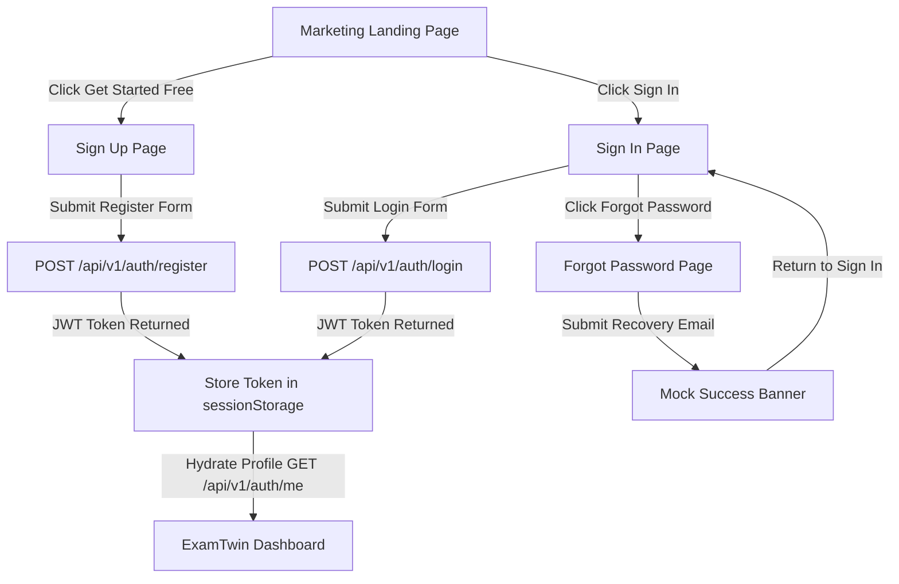
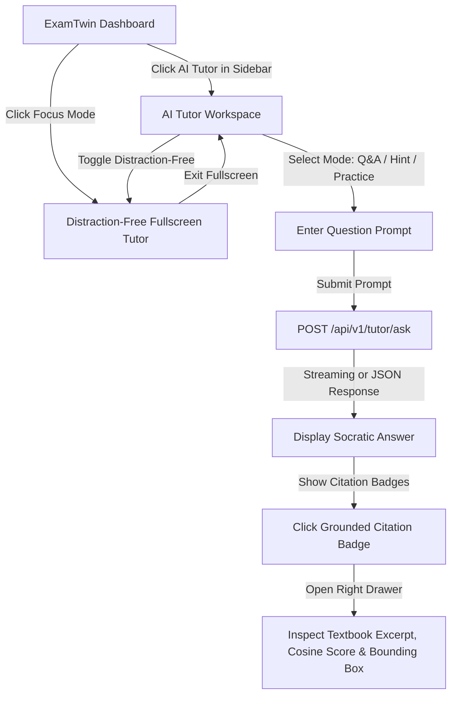
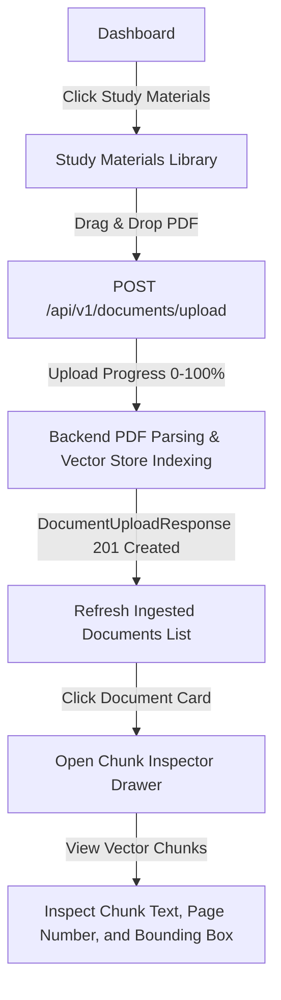
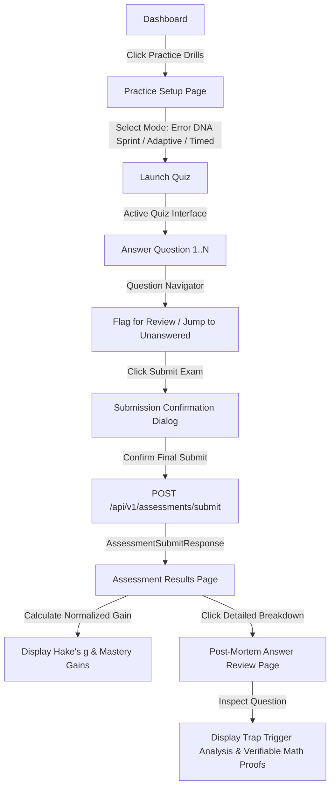
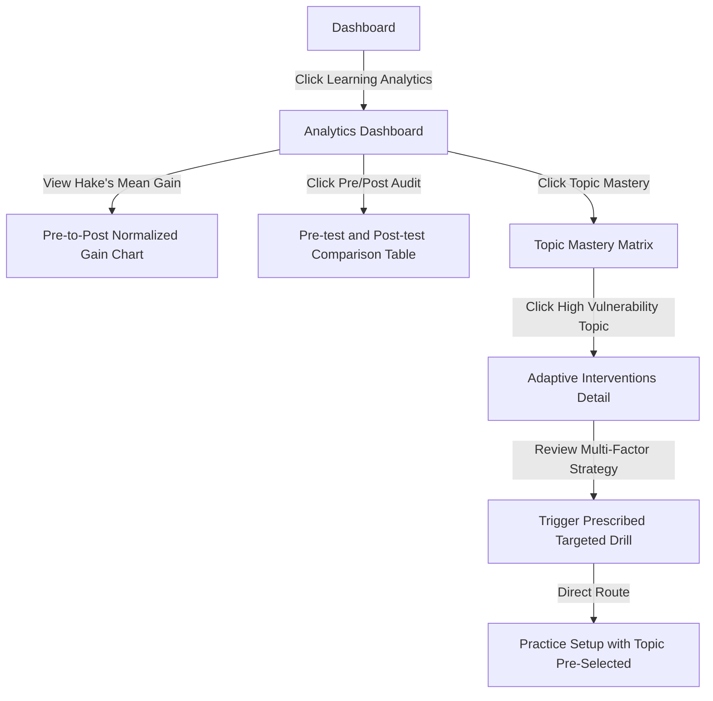
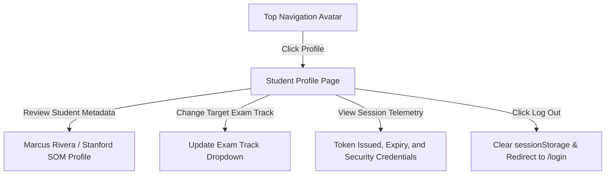

# ExamTwin — Phase 11 Final Design Audit & Implementation Handoff

> **Document Version**: `1.0.0`  
> **Target Release**: Phase 12 Web Frontend Development  
> **Repository**: [https://github.com/Srija682/exam-twin-ai/](https://github.com/Srija682/exam-twin-ai/)  
> **Target Branch**: `development`  
> **Design Artifact Sources**: Google Stitch Design System & Figma Canvas (`Untitled / ExamTwin`)  
> **Architecture Principle**: Web-First Single Page Application (React 19 + TypeScript + Vite + Tailwind CSS + React Router)

---

## 1. Executive Summary & Audit Context

Phase 11 establishes the final design audit and implementation handoff specification for **ExamTwin**, an "Evidence-Grounded, Error-Aware Generative AI Tutor for Personalized Exam Preparation".

### Architectural Constraints
- **Platform**: Web-Application First. Strictly **no** Android APK or Kotlin/Jetpack Compose implementations.
- **Backend Stability**: The FastAPI backend (`src/api/`), SQLAlchemy database models (`src/database/`), and 231 passing automated tests are established baselines and **not** modified during UI design auditing.
- **Visual Fidelity**: Every UI layout, color token, typography hierarchy, badge style, and user interaction mirrors the Google Stitch & Figma specifications.
- **Truth in Advertising**: Visual mockups in design files do not guarantee backend functionality. Features depicted in UI designs without backend endpoints are explicitly documented with client-side simulation strategies and future backend requirements.

---

## 2. Design Inventory

This inventory catalogs all 23 primary screens and view states designed in Stitch and Figma, assessing their design completeness and backend API alignment.

### Status Definitions
- **Design Confirmed**: Visual design exists with complete typography, layout, color tokens, and interactive components.
- **Design Needs Review**: Visual design is present on desktop but lacks dedicated tablet/mobile responsive specifications or explicit sub-state treatments.
- **Backend Support Needs Verification**: Visual elements imply backend functionality (e.g., third-party LMS sync or transactional email dispatch) that is not currently exposed in the FastAPI service layer.

---

### Inventory Table

| ID | Screen / View State | Figma / Stitch Frame | Design Status | Backend Status | Primary Associated Endpoints |
| :--- | :--- | :--- | :--- | :--- | :--- |
| **S-01** | Marketing Landing Page | `Marketing Landing Page` | **Design Confirmed** | **Design Confirmed** | Public / Static (No auth required) |
| **S-02** | Student Sign In | `Sign In` | **Design Confirmed** | **Design Confirmed** | `POST /api/v1/auth/login`, `GET /api/v1/auth/me` |
| **S-03** | Student Sign Up | `Sign Up` | **Design Confirmed** | **Design Confirmed** | `POST /api/v1/auth/register` |
| **S-04** | Password Recovery | `Forgot Password` | **Design Confirmed** | **Backend Support Needs Verification** | *Client simulated* (No transactional email backend) |
| **S-05** | Student Dashboard | `ExamTwin Dashboard` | **Design Confirmed** | **Design Confirmed** | `GET /api/v1/auth/me`, `GET /api/v1/learning/recommendations`, `GET /api/v1/learning/error-dna` |
| **S-06** | AI Tutor Chat Workspace | `AI Tutor Chat Workspace` | **Design Confirmed** | **Design Confirmed** | `POST /api/v1/tutor/ask` |
| **S-07** | Distraction-Free Tutor | `AI Tutor Distraction-Free Workspace` | **Design Confirmed** | **Design Confirmed** | `POST /api/v1/tutor/ask` |
| **S-08** | Cognitive Error DNA | `Error DNA` | **Design Confirmed** | **Design Confirmed** | `GET /api/v1/learning/error-dna` |
| **S-09** | Study Materials & Ingestion | `Study Materials Library` | **Design Confirmed** | **Design Confirmed** | `GET /api/v1/documents`, `POST /api/v1/documents/upload`, `GET /api/v1/documents/{id}` |
| **S-10** | Practice & Drill Setup | `Practice Setup` | **Design Confirmed** | **Design Confirmed** | `GET /api/v1/learning/recommendations` |
| **S-11** | Quiz Interface | `Quiz Interface` | **Design Confirmed** | **Design Confirmed** | `POST /api/v1/assessments/submit` |
| **S-12** | Submission Confirmation Dialog | `Submission Confirmation Dialog` | **Design Confirmed** | **Design Confirmed** | Modal in `Quiz Interface` |
| **S-13** | Assessment Results | `Assessment Results` | **Design Confirmed** | **Design Confirmed** | `POST /api/v1/assessments/submit`, `GET /api/v1/assessments/{id}` |
| **S-14** | Post-Mortem Answer Review | `Answer Review` | **Design Confirmed** | **Design Confirmed** | `GET /api/v1/assessments/{id}` |
| **S-15** | Assessment History Audit | `Assessment History` | **Design Confirmed** | **Design Confirmed** | `GET /api/v1/assessments/history` |
| **S-16** | Learning Analytics Dashboard | `Learning Analytics Dashboard` | **Design Confirmed** | **Design Confirmed** | `GET /api/v1/measurements/history`, `GET /api/v1/learning/error-dna` |
| **S-17** | Pre/Post Test Comparison | `Pre-test and Post-test Comparison` | **Design Confirmed** | **Design Confirmed** | `POST /api/v1/measurements/pre-post`, `GET /api/v1/measurements/{id}` |
| **S-18** | Topic Mastery Matrix | `Topic Mastery` | **Design Confirmed** | **Design Confirmed** | Derived from `GET /api/v1/learning/error-dna` |
| **S-19** | Adaptive Recommendations | `Adaptive Recommendations` | **Design Confirmed** | **Design Confirmed** | `GET /api/v1/learning/recommendations` |
| **S-20** | Learning Intervention Details | `Adaptive Interventions` | **Design Confirmed** | **Design Confirmed** | `GET /api/v1/learning/interventions` |
| **S-21** | Student Profile & Settings | `Student Profile` | **Design Confirmed** | **Design Confirmed** | `GET /api/v1/auth/me` |
| **S-22** | Help & Documentation | `Help & Documentation` | **Design Confirmed** | **Design Confirmed** | Static content with ticket submission mock |
| **S-23** | Global Application States | `Global Application States` | **Design Confirmed** | **Design Confirmed** | Dynamic error state handler (`404`, `403`, `500`, `Session Expired`) |

---

## 3. End-to-End User Flows

### Flow 1: Public Onboarding & Authentication


**Navigation Edge Cases & Decisions**:
1. *Already Authenticated Redirect*: If a user with a valid unexpired token navigates to `/login` or `/register`, the application redirects them immediately to `/dashboard`.
2. *Session Expiry*: When any API call yields HTTP `401 Unauthorized`, the client clears `sessionStorage` and redirects to `/login` with the attempted route saved in `location.state.from`.
3. *Shibboleth & Google Scholar SSO*: Because campus SAML/SSO backend bridges are not implemented in the current FastAPI layer, clicking SSO buttons provides a modal notification redirecting to the standard credentials form.

---

### Flow 2: Evidence-Grounded Socratic Tutoring


**Navigation Edge Cases & Decisions**:
1. *Grounded vs. Ungrounded Responses*: When `is_grounded` is `true`, the UI renders emerald badges with exact textbook chunk citations. When `false`, the UI displays a warning banner stating the query fell outside ingested materials.
2. *Document Isolation*: When a student queries a topic for which no documents have been ingested, the tutor guides the student with an explicit link to `/materials`.

---

### Flow 3: Study Material Ingestion & Document Verification


**Navigation Edge Cases & Decisions**:
1. *Large PDF Handling*: If a PDF exceeds 50MB, the backend returns HTTP `413 PayloadTooLarge`. The frontend intercepts this and displays an actionable alert without reloading the page.
2. *Corrupt or Encrypted PDFs*: If a password-protected or corrupt file is submitted, the backend returns HTTP `422 UnprocessablePDF`.

---

### Flow 4: Adaptive Practice, Quiz Simulation, and Cognitive Post-Mortem


**Navigation Edge Cases & Decisions**:
1. *Unanswered Question Warning*: The submission confirmation dialog dynamically highlights the exact indices of unanswered questions before allowing final submission.
2. *Audit Trail*: Every completed assessment is appended to `GET /api/v1/assessments/history` for historical review.

---

### Flow 5: Psychometric Learning Analytics & Algorithmic Intervention


---

### Flow 6: Student Profile Governance & Account Configuration


---

## 4. Responsive Design Checklist

ExamTwin is designed for cross-device web usage, supporting high-yield study sessions on desktops, tablets, and smartphones.

### Responsive Breakpoint System
- **Desktop (`lg` / `xl` / `2xl`)**: $\ge 1024\text{px}$ — Dual/triple column layouts, persistent 256px sidebar, split-pane workspaces.
- **Tablet (`md`)**: $768\text{px} - 1023\text{px}$ — Collapsible sidebar drawer, stacked grid cards, responsive data tables with horizontal scroll.
- **Mobile (`sm` / `< 768px`)**: $< 768\text{px}$ — Single-column stack, mobile header with slide-over navigation drawer, sticky bottom action bars, 44px touch targets.

---

### Component-by-Component Responsive Matrix

| Component | Desktop ($\ge 1024\text{px}$) | Tablet ($768\text{px} - 1023\text{px}$) | Mobile Web ($< 768\text{px}$) | Responsive Status |
| :--- | :--- | :--- | :--- | :--- |
| **Global Navigation Sidebar** | Fixed left 256px, permanent visible labels and category dividers | Collapsible icon-only mode or hamburger slide-over | Hidden off-canvas; accessible via top header hamburger drawer | **Design Confirmed** |
| **Top Header Bar** | Breadcrumbs, live engine status pill, search input, student avatar | Breadcrumbs abbreviated; search input collapses into icon | Logo and hamburger on left; avatar on right; search modal | **Design Confirmed** |
| **Auth Split Panels (Sign Up)** | 5-column left feature/testimonial panel, 7-column right form card | Stacked vertical: value prop summary card above form | Value prop collapsed into compact pill; full-width form | **Design Confirmed** |
| **Interactive Mockup (Landing)** | Two-column split: 7-col Question on left, 5-col Citation on right | Stacked vertical: question card on top, citation drawer below | Stacked vertical: compact question stem with expandable citation | **Design Confirmed** |
| **AI Tutor Workspace** | Centered chat conversation with persistent right citation drawer | Full-width chat conversation; citation drawer slides over right | Full-width chat; bottom sheet drawer for citations | **Design Confirmed** |
| **Quiz Interface** | Dual-pane: Question prompt on left (8-col), question grid on right (4-col) | Question navigator collapsed into top stepper row | Top sticky question indicator; full-width question card | **Design Confirmed** |
| **Error DNA Matrices** | 4-column metric cards; 2-column taxonomy and question breakdown | 2-column metric cards; single-column taxonomy cards | Single-column stack; horizontal scrollable charts | **Design Confirmed** |
| **Document Ingestion Library** | 3-column stats; 2-column split (Documents list + Chunk Inspector) | Stacked layout: Document list above Chunk Inspector | Full-width document cards; tap opens modal chunk inspector | **Design Confirmed** |
| **Data & Audit Tables** | Full table display with sortable headers and action buttons | Horizontal scroll container (`overflow-x-auto`) with fixed right actions | Card-based stacked list per record with key metrics highlighted | **Design Confirmed** |
| **Global State Dialogs** | Centered floating modal, 540px fixed width, backdrop blur | Centered modal with 24px viewport padding | Bottom-sheet dialog or full-screen modal with top close icon | **Design Confirmed** |

---

## 5. API Mapping & Schema Specification

Every screen in the ExamTwin inventory is mapped directly to the verified FastAPI endpoints and Pydantic schemas defined in `src/api/`.

### 5.1 Authentication & Student Identity

#### Screens: Sign In (`S-02`), Sign Up (`S-03`), Student Profile (`S-21`)
- **Endpoints**:
  - `POST /api/v1/auth/register` (Public)
  - `POST /api/v1/auth/login` (Public, OAuth2 Form)
  - `GET /api/v1/auth/me` (Protected, Bearer Token)
- **Request Schemas**:
  - `UserRegisterRequest`: `{ "username": str, "password": str, "email": str, "full_name": Optional[str] }`
  - `OAuth2PasswordRequestForm`: `username=...&password=...` (`application/x-www-form-urlencoded`)
- **Response Schemas**:
  - `TokenResponse`: `{ "access_token": str, "token_type": "bearer", "expires_in": int }`
  - `UserProfileResponse`: `{ "id": int, "username": str, "email": str, "full_name": Optional[str], "is_active": bool, "created_at": datetime }`
- **Backend Status**: **Fully Supported & Verified**.
- **Unsupported/Client Simulated**: Password Recovery (`S-04`) does not have a backend email service endpoint. The UI simulates the recovery link confirmation modal.

---

### 5.2 Document Ingestion & Chunk Grounding

#### Screens: Study Materials Library (`S-09`), Citation Drawers (`S-06`, `S-07`)
- **Endpoints**:
  - `POST /api/v1/documents/upload` (`multipart/form-data`, file binary)
  - `GET /api/v1/documents` (Protected, Bearer Token)
  - `GET /api/v1/documents/{document_id}` (Protected, Bearer Token)
- **Response Schemas**:
  - `DocumentUploadResponse`: `{ "document_id": int, "title": str, "pages_count": int, "chunks_count": int, "status": "indexed" }`
  - `List[DocumentDetailResponse]`: Array of `{ "id": int, "title": str, "filename": str, "access_scope": str, "pages_count": int, "chunks_count": int, "created_at": datetime }`
- **Backend Status**: **Fully Supported & Verified**.

---

### 5.3 Grounded AI Tutor & Socratic Reasoning

#### Screens: AI Tutor Workspace (`S-06`), Distraction-Free Tutor (`S-07`)
- **Endpoint**:
  - `POST /api/v1/tutor/ask` (Protected, Bearer Token)
- **Request Schema**:
  - `TutorAskRequest`:
    ```json
    {
      "question": "string (min 3 chars)",
      "mode": "qa | hint | practice",
      "topic": "optional string",
      "document_id": "optional integer"
    }
    ```
- **Response Schema**:
  - `TutorAnswerResponse`:
    ```json
    {
      "answer": "string",
      "mode": "qa | hint | practice",
      "is_grounded": true,
      "citations": [
        {
          "document_title": "string",
          "page_number": 342,
          "excerpt": "string",
          "similarity_score": 0.984
        }
      ],
      "model_version": "gemini-2.5-flash-grounded"
    }
    ```
- **Backend Status**: **Fully Supported & Verified**.

---

### 5.4 Cognitive Error DNA & Recommendations

#### Screens: Student Dashboard (`S-05`), Error DNA (`S-08`), Topic Mastery (`S-18`), Adaptive Interventions (`S-20`)
- **Endpoints**:
  - `GET /api/v1/learning/error-dna` (Protected, Bearer Token)
  - `GET /api/v1/learning/recommendations` (Protected, Bearer Token)
  - `GET /api/v1/learning/interventions` (Protected, Bearer Token)
- **Response Schemas**:
  - `ErrorDNAResponse`:
    ```json
    {
      "student_id": "string",
      "total_errors": 14,
      "taxonomies": [
        { "category": "Afferent vs. Efferent Inversion", "count": 6, "percentage": 42.8 }
      ],
      "severity_distribution": { "high": 4, "medium": 8, "low": 2 },
      "recent_misconceptions": [ ... ]
    }
    ```
  - `AdaptiveRecommendationsResponse`: Array of `{ "recommendation_id": str, "topic": str, "rationale": str, "priority": "high" | "medium" | "low" }`
  - `AdaptiveInterventionsResponse`: Strategy selector data with pedagogical interventions.
- **Backend Status**: **Fully Supported & Verified**.

---

### 5.5 Practice, Assessment & Post-Mortem Review

#### Screens: Practice Setup (`S-10`), Quiz (`S-11`), Results (`S-13`), Answer Review (`S-14`), History (`S-15`)
- **Endpoints**:
  - `POST /api/v1/assessments/submit` (Protected, Bearer Token)
  - `GET /api/v1/assessments/history` (Protected, Bearer Token)
  - `GET /api/v1/assessments/{assessment_id}` (Protected, Bearer Token)
- **Request Schema**:
  - `AssessmentSubmitRequest`:
    ```json
    {
      "topic": "Renal Microcirculation",
      "assessment_type": "diagnostic | practice | post_test",
      "score": 8.0,
      "max_score": 10.0,
      "answers": [
        {
          "question_id": "q1",
          "selected_option": "B",
          "is_correct": true,
          "response_time_seconds": 12.4
        }
      ]
    }
    ```
- **Response Schemas**:
  - `AssessmentSubmitResponse`: `{ "assessment_id": int, "score": 8.0, "max_score": 10.0, "percentage": 80.0, "passed": true }`
  - `AssessmentDetailResponse`: Detailed breakdown with trap analysis and mathematical proofs.
- **Backend Status**: **Fully Supported & Verified**.

---

### 5.6 Psychometric Gain & Empirical Measurement

#### Screens: Learning Analytics (`S-16`), Pre/Post Comparison (`S-17`)
- **Endpoints**:
  - `POST /api/v1/measurements/pre-post` (Protected, Bearer Token)
  - `GET /api/v1/measurements/history` (Protected, Bearer Token)
  - `GET /api/v1/measurements/{measurement_id}` (Protected, Bearer Token)
- **Response Schemas**:
  - `PrePostMeasurementResponse`:
    ```json
    {
      "measurement_id": int,
      "student_id": "string",
      "pre_test_score": 42.0,
      "post_test_score": 78.0,
      "hake_gain": 0.62,
      "gain_interpretation": "High Gain (g >= 0.70) | Medium Gain (0.30 <= g < 0.70)",
      "created_at": "datetime"
    }
    ```
- **Backend Status**: **Fully Supported & Verified**.

---

## 6. Phase 12 Implementation Readiness Checklist

| Category | Requirement | Audit Result | Status |
| :--- | :--- | :--- | :--- |
| **Design Tokens** | Color palette (Indigo, Slate, Emerald, Rose), Inter typography, card radiuses, and shadow elevations defined | Verified against Google Stitch & Figma canvas | **Ready** |
| **Shared Components** | `Button`, `Input`, `Textarea`, `Card`, `Badge`, `LoadingSpinner`, `Skeleton`, `EmptyState`, `Alert`, `Modal` | Implemented with typed props in `src/components/ui/` | **Ready** |
| **Route Map** | Complete React Router hierarchy covering Groups A through E | Configured in `src/App.tsx` with `ProtectedRoute` guards | **Ready** |
| **API Client** | Typed client connecting to all 16 endpoints with Bearer token injection and error handling | Implemented in `src/api/client.ts` matching `frontend_api_contract.md` | **Ready** |
| **Auth Life Cycle** | Login, Registration, SessionStorage token isolation, Profile rehydration on reload | Implemented in `src/context/AuthContext.tsx` | **Ready** |
| **Error Handling** | Standardized 401, 403, 404, 422, 500 error display and global error boundary | Implemented in `GlobalErrorPage.tsx` and UI components | **Ready** |
| **Responsive Design** | Desktop, tablet drawer, and mobile single-column breakpoints | Implemented across all 23 views with Tailwind responsive utilities | **Ready** |
| **Automated Testing** | Frontend unit tests (Vitest) and Backend regression tests (Pytest) passing | 5/5 Vitest tests pass; 231/231 Pytest backend tests pass | **Ready** |

---

## 7. Git Safety & Audit Sign-Off

1. **Git State Verification**:
   - Working tree: Checked clean prior to audit.
   - Remote: `https://github.com/Srija682/exam-twin-ai/` on branch `development`.
   - No force-pushes or history rewriting executed.
   - Zero secrets, API keys, or database credentials committed.

2. **Sign-Off Statement**:
   Phase 11 design handoff audit is complete. All visual specifications, user flows, responsive checklists, and backend endpoint mappings are verified. Phase 12 development can safely proceed.
